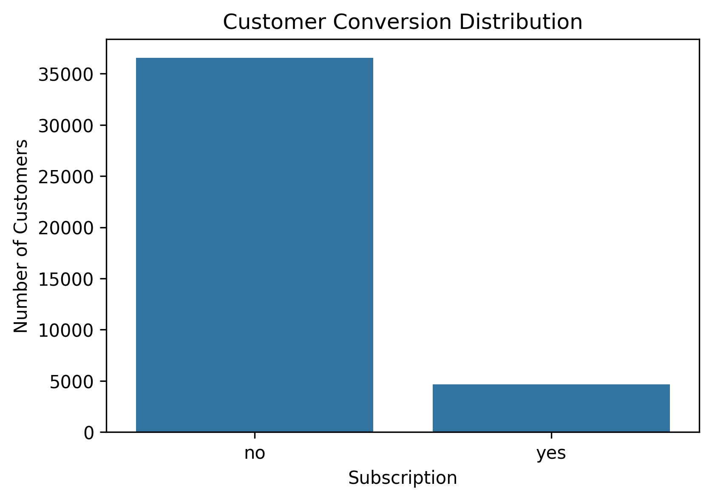
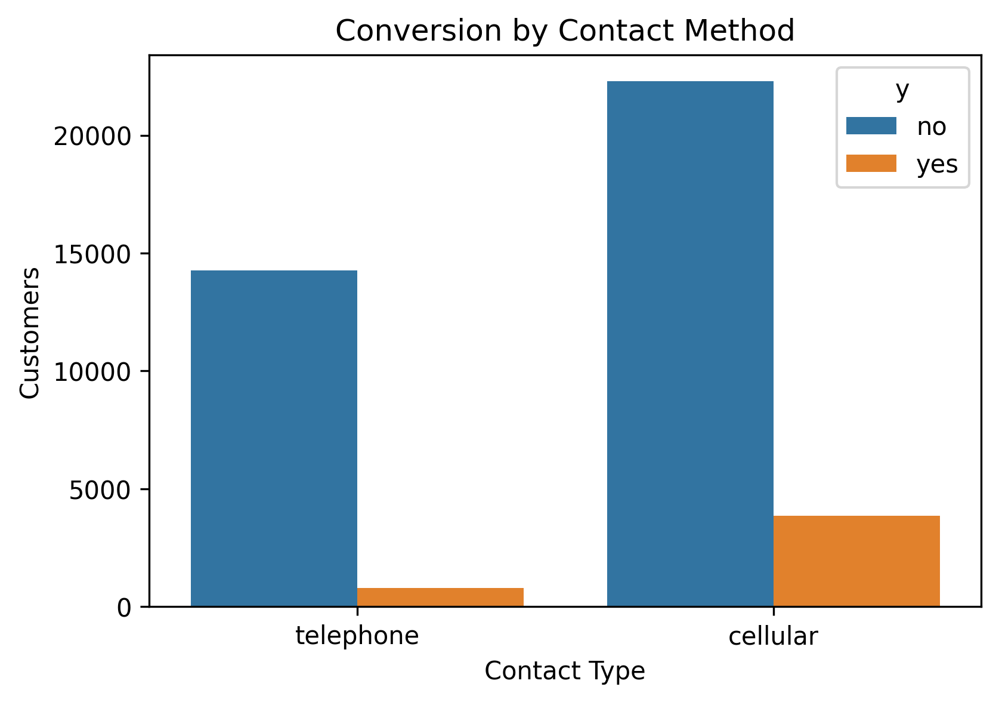
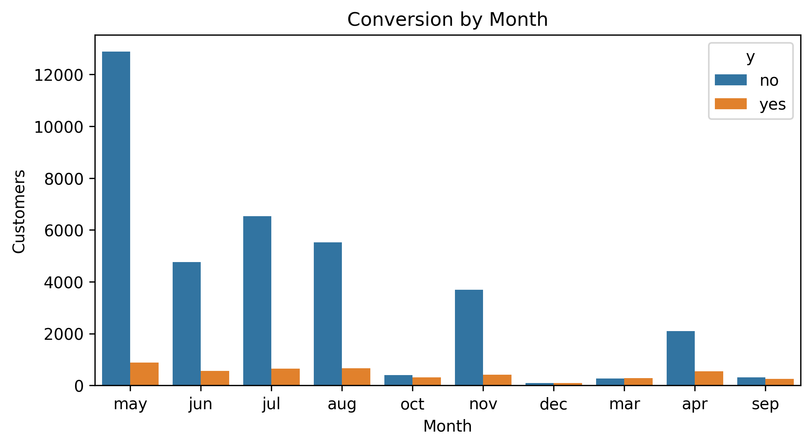
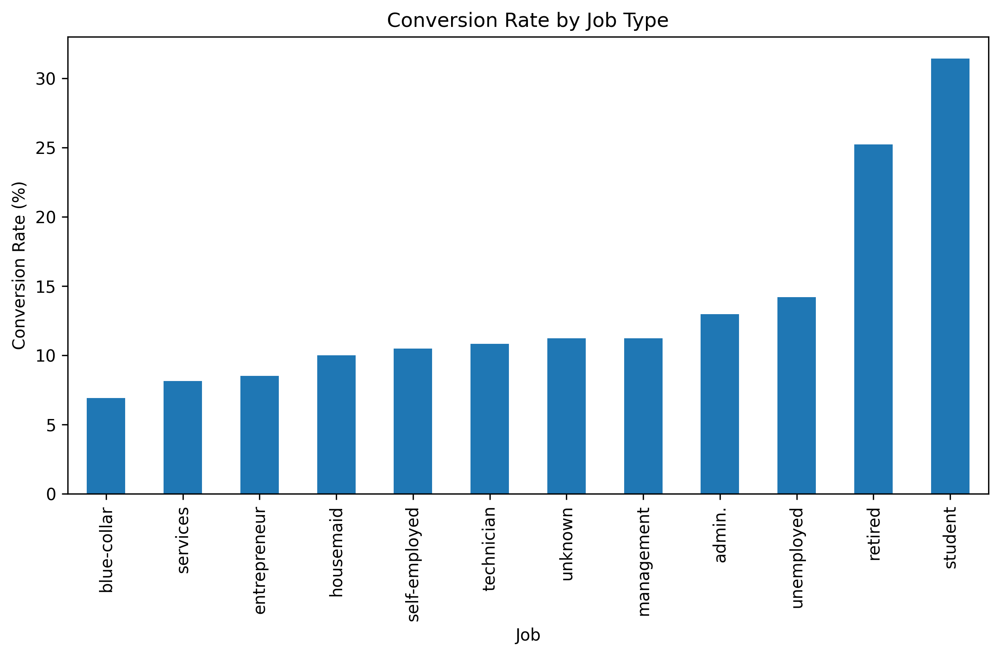
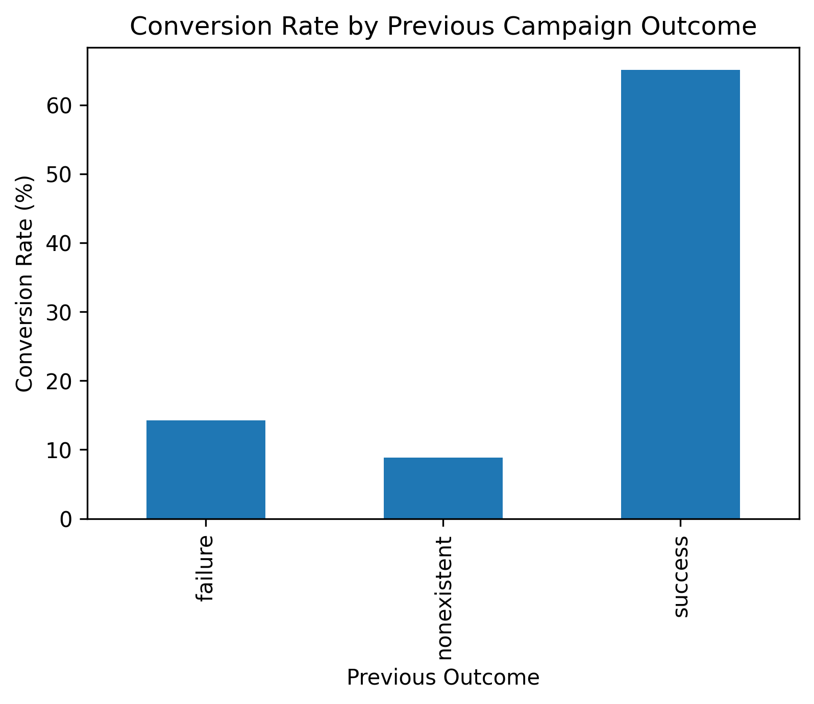

# Marketing Funnel & Conversion Performance Analysis

## Project Overview
This project analyzes marketing campaign data from a bank to understand customer conversion behavior. The goal is to identify conversion drop-offs, evaluate channel performance, and provide insights to improve marketing effectiveness.

## Dataset
The dataset contains information about customers contacted during direct marketing campaigns for term deposit subscriptions.

Total Records: 41,188  
Total Features: 21  

Target Variable:
- **y** → Indicates whether the customer subscribed to a term deposit (yes/no)

## Tools Used
- Python
- Pandas
- Matplotlib
- Seaborn
- VS Code

## Marketing Funnel
The marketing funnel in this dataset follows the structure:

Customers Contacted → Campaign Interaction → Subscription

Total customers contacted: **41,188**

Customers subscribed: **4,640**

Overall conversion rate: **11.27%**

## Key Insights

### 1. Overall Conversion
Only around **11% of contacted customers subscribed**, indicating a significant drop-off in the marketing funnel.

### 2. Best Contact Method
Cellular contact performs significantly better than telephone marketing.

Cellular conversion rate ≈ **14.7%**  
Telephone conversion rate ≈ **5.2%**

### 3. Customer Segments
Students and retired individuals show the highest conversion rates.

Blue-collar workers show the lowest conversion rates.

### 4. Previous Campaign Impact
Customers who previously responded successfully to marketing campaigns have a much higher probability of converting again.

## Visualizations
The following charts were created to analyze marketing performance:

- Customer Conversion Distribution
- Conversion by Contact Method
- Conversion by Month
- Conversion Rate by Job Type
- Conversion Rate by Previous Campaign Outcome

## Business Recommendations

1. Focus marketing campaigns on **students and retired customers**.
2. Increase use of **cellular contact channels** instead of telephone.
3. Retarget customers who had **successful responses in previous campaigns**.
4. Optimize campaigns during **high-performing months**.

## Project Structure
FUTURE_DS_03
│
├── data → Dataset
├── notebook → Analysis notebook
├── dashboard → Saved visualization images
├── report → Project summary report
└── README.md

## Conclusion
The analysis highlights key factors influencing customer conversion and provides actionable insights to improve marketing campaign performance.

## Dashboard Visualizations

### Customer Conversion Distribution

### Conversion by Contact Method

### Conversion by Month

### Conversion Rate by Job Type

### Conversion by Previous Campaign Outcome
